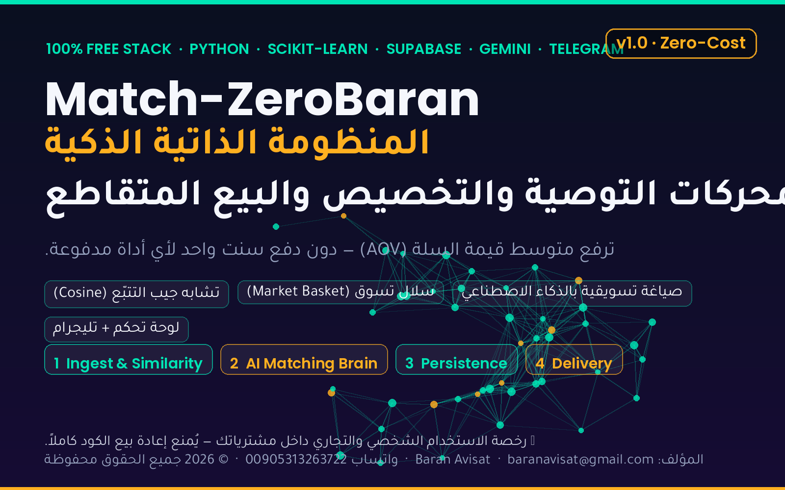

# Match-ZeroBaran
### المنظومة الذاتية الذكية لمحركات التوصية · تخصيص المنتجات · البيع المتقاطع

**by Baran Avisat** · baranavisat@gmail.com · WhatsApp 00905313263722



---

> نظام ذكي متكامل ومستقل لتحليل سلوك المستهلك وتفضيلاته، وتقديم توصيات
> مخصّصة ودقيقة للمنتجات: *«العميل الذي اشترى X غالباً ما يناسبه Y»* —
> **بموارد مجانية 100%، وبدون دفع دولار واحد لأي أداة توصيات مدفوعة.**

---

## 💰 لماذا يريده كل متجر؟

| الميزة | الأثر |
|---|---|
| ** توفير مال فلكي** | اشتراكات محركات التوصية والتخصيص تكلّف المتاجر ثروات شهرياً — هذا النظام يُ performs نفسها بتكلفة صفر. |
| ** قفزة في AOV** | رفع متوسط قيمة الطلب عبر عرض المنتج المناسب للعميل المناسب في اللحظة المثالية. |
| ** سيادة وخصوصية** | سجلات مشتريات عملائك لا تُشارك مع أي شركة تسويق خارجية — تُعالج محلياً أو في قاعدة بياناتك أنت. |
| ** صفر قفل (No lock-in)** | كل شيء قابل للتصدير: CSV، JSON، Supabase — بياناتك ملكك. |

## 🛠️ الموارد المجانية البحتة

| المكوّن | الخدمة المجانية | الدور |
|---|---|---|
| الجدولة (Cron) | **GitHub Actions** | تحديث مصفوفات التوصيات كل 6 ساعات + الاختبارات |
| محرك المعالجة | **Python + NumPy + scikit-learn** | Cosine Similarity (TF‑IDF) + تحليل سلال التسوق (Lift) |
| القاعدة السحابية | **Supabase (PostgreSQL + pgvector)** — اختياري | متجهات المنتجات واستعلامات فورية |
| عقل الكتابة | **Google Gemini / Groq** (مجاني) | صياغة سبب الاختيار بأسلوب مقنع — مع بديل قوالب صفر-مفاتيح |
| التسليم | **Telegram Bot API** | إرسال حزم التوصيات فوراً |
| الواجهة | **Streamlit** | خريطة المبيعات وأزواج الشراء المتقاطع |
| تخزين المخزن | **JSON محلي** (افتراضي) | يعمل بلا إنترنت وبلا إعداد |

> 🔑 **صفر مفاتيح افتراضياً**: إن لم تضبط أي مفتاح يعمل النظام كاملاً بمحرّك القوالب العربي/الإنجليزي.

## 📐 البنية — 4 طبقات

```
[1] طبقة المعالجة والتشابه      data/*.csv ──► TF-IDF cosine + basket lift
[2] عقل التوصية (AI Brain)      Gemini ► Groq ► templates (fallback)
[3] طبقة الأرشيف               local JSON ► Supabase/pgvector (اختياري)
[4] طبقة التوصيل                Telegram digest + Streamlit dashboard
```

## ⚡ البدء السريع

```bash
git clone <this-repo> && cd Match-ZeroBaran
python -m venv .venv && source .venv/bin/activate
pip install -r requirements.txt

python -m matchzerobaran init          # استيراد بيانات المتجر التجريبية
python -m matchzerobaran status         # أي عقل يعمل الآن؟
python -m matchzerobaran recommend --customer C001 -k 3
python -m matchzerobaran report         # إيراد · AOV · أهم أزواج البيع
```

المخرجات (بالعربية افتراضياً):

```
 1. Camera Backpack 25L [bags] 95 score=0.812
    ↳ يُشترى عادةً مع DSLR Camera Kit 24MP
    ↳ اشتريت DSLR Camera Kit 24MP مؤخراً، و«Camera Backpack 25L» هو الرفيق…
```

### تشغيل لوحة التحكم

```bash
pip install -r requirements-dashboard.txt
streamlit run dashboard/app.py
```

### النسخ إلى تليجرام

```bash
export TELEGRAM_BOT_TOKEN=...   # من @BotFather
export TELEGRAM_CHAT_ID=...     # مثلاً عبر getUpdates
python -m matchzerobaran recommend --customer C001 --notify
```

## 🗂️ مصادر بياناتك

ضع ملفاتك في `data/` بالصيغة الموضّحة في [data/SOURCES.md](data/SOURCES.md):

```csv
# orders.csv  (سطر لكل منتج داخل الطلب)
order_id,customer_id,ts,product_id,qty,price
O1001,C001,2026-09-02,P001,1,650
```

## 🤖 المجدول في GitHub Actions

`.github/workflows/refresh.yml` يعمل كل 6 ساعات مجاناً:

1. يشغّل الاختبارات
2. يعيد بناء مصفوفة التوصيات لكل العملاء
3. يرفع `recommendations.json` كـ Artifact (14 يوماً)
4. اختيارياً يرسل خلاصة التاجر إلى تليجرام

اضبط الأسرار في **Settings → Secrets and variables → Actions**:
`GEMINI_API_KEY` · `GROQ_API_KEY` · `TELEGRAM_BOT_TOKEN` · `TELEGRAM_CHAT_ID` ·
`SUPABASE_URL` · `SUPABASE_SERVICE_KEY` — ولا تُرفع الأسرار إلى الكود أبداً.

## 📚 التوثيق

* [docs/ARCHITECTURE.md](docs/ARCHITECTURE.md) — التصميم الهندسي والخوارزميات
* [docs/STACK.md](docs/STACK.md) — لماذا كل مكوّن مجاني وكيف يبقى صفر تكلفة
* [docs/SUPABASE.md](docs/SUPABASE.md) — إعداد pgvector خطوة بخطوة
* [docs/API.md](docs/API.md) — ربط النظام بمتجرك (HTTP + Python)
* [docs/DEPLOY.md](docs/DEPLOY.md) — دليل النشر الكامل

## 🧪 الاختبارات

```bash
python -m unittest discover -s tests -v
```

## ⚖️ الحقوق والدعم

**© 2026 Baran Avisat — جميع الحقوق محفوظة.**

* المؤلف: **Baran Avisat**
* البريد: **baranavisat@gmail.com**
* واتساب: **00905313263722**
* الرخصة: [MIT](LICENSE) للكود + [NOTICE](NOTICE) لحقوق العلامة والتزام الاقتباس

يُمنع إعادة بيع الكود كاملاً أو إعادة تسميته. أي نشر مشتق يجب أن يحتفظ بسطر
الاقتباس أعلاه في الواجهات والتقارير المولّدة.

---

> صُنع 💚 بموارد مجانية بالكامل — ليعمل ليل نهار دون فاتورة واحدة.